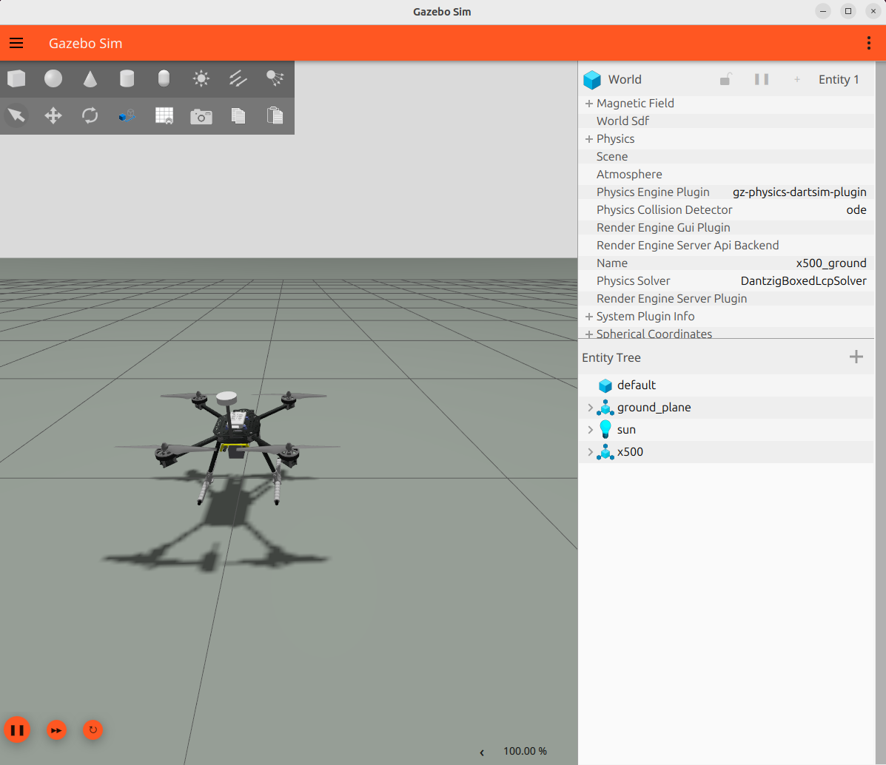
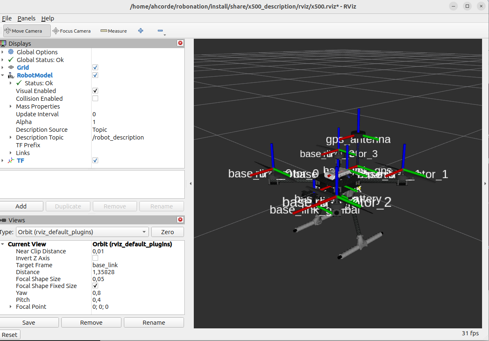

# Running the simulation

```bash
ros2 launch x500_gazebo sim.launch.xml
```

Launches the vehicle in its default configuration: every artifact of the
loadout is generated at start (URDF, composed model, bridge config, into
a directory under `$ROS_HOME`), the model is spawned as `x500` into the
ground world and the ROS bridge comes up with it. The vehicle rests on
its landing gear; the rotors idle until something publishes on the motor
bus ([Actuators](actuators.md)).



To run a custom vehicle instead, pass a loadout file with `config_file:=`;
the [configuration page](configuration.md) lists the slots and
[Change the loadout](../../how-to/index.md) walks through writing one.

| Argument | Default | Meaning |
|---|---|---|
| `config_file` | the shipped config | Vehicle loadout, expanded at launch. |
| `name` | `x500` | Instance name: the Gazebo model name, the topic namespace (`/<name>/...`) and the TF prefix; letters, digits and underscores. See [Several vehicles](../../how-to/index.md#several-vehicles). |
| `x`, `y`, `z` | `0`, `0`, `0.25` | Spawn position (m); the default drops onto the landing gear. |
| `roll`, `pitch`, `yaw` | `0` | Spawn orientation (rad). |
| `world` | the ground world | Vehicle free world SDF to spawn into. |
| `gui` | `true` | Start the Gazebo GUI. |
| `rviz` | `false` | Start RViz on the instance's frames. |
| `use_composition` | `true` | Run the server, the bridge and the state publisher in one process. |

## Choosing the world

By default the vehicle is spawned into the vehicle free ground world
(`x500_ground.sdf`). The `world:=` argument swaps the environment without
changing anything else about the simulation: pass any vehicle free world
SDF:

```bash
ros2 launch x500_gazebo sim.launch.xml world:=/path/my_world.sdf
# for example
ros2 launch x500_gazebo sim.launch.xml world:="$(ros2 pkg prefix --share x500_gazebo)/worlds/x500_playground.sdf"
```

## In RViz

To watch the simulation in RViz, ask the sim launch for it:

```bash
ros2 launch x500_gazebo sim.launch.xml rviz:=true
```

The frames carry the instance name (`<name>/base_link`), so this RViz has
its fixed frame and its RobotModel TF prefix set to the instance.

To see the model in RViz without Gazebo, with sliders to spin the rotors:

```bash
ros2 launch x500_description display.launch.xml
```

This launch stands alone: it runs a state publisher of its own, so do not
run it next to `sim.launch.xml`.


